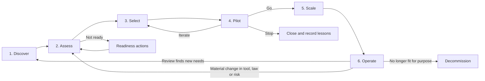

# The adoption lifecycle

> **Who this is for:** Anyone planning, running or overseeing the introduction of AI tools: sponsors, programme leads, IT, risk, and the teams who will use the tools.
> **Last reviewed:** 2026-10

This section sets out a six-stage workflow for adopting AI tools, from first ideas to running tools in production and, eventually, retiring them. Each stage has a purpose, entry and exit criteria, the roles involved, and a decision gate. The stages are a structure for thinking, not a bureaucracy: a ten-person firm might move through all six in a few weeks with one person wearing most of the hats, while a regulated enterprise might run several use cases through the cycle in parallel with formal governance at each gate. Use the overview below to locate where you are, then go to the stage page.

## The six stages at a glance

| Stage | Question it answers | Typical duration (indicative only) | Main output |
|---|---|---|---|
| [1. Discover](01-discover.md) | What could AI do for us, and why? | 2–6 weeks | A long list of problem-framed opportunities and a picture of current (including unsanctioned) AI use |
| [2. Assess](02-assess.md) | Are we ready, and what are the risks? | 2–8 weeks | Readiness, data, risk and legal assessments for the shortlisted opportunities |
| [3. Select](03-select.md) | Which use cases and tools, against which criteria? | 3–12 weeks | Prioritised use cases, a build/buy/configure decision, and a chosen tool with contract terms |
| [4. Pilot](04-pilot.md) | Does it work for us in practice? | 6–16 weeks | Evidence against pre-agreed success criteria and a go/no-go decision |
| [5. Scale](05-scale.md) | How do we roll it out safely and well? | Months | Wider deployment with enablement, support and governance in place |
| [6. Operate](06-operate.md) | How do we run, monitor and improve it? | Ongoing | Monitoring, incident handling, change control, review cycles and, when needed, decommissioning |

Durations are illustrative ranges drawn from common practice, not benchmarks. Your timeline depends on organisation size, procurement rules, risk level and the tool involved.

## How the stages connect

The lifecycle is iterative. A pilot that fails its criteria should send you back to Select (different tool) or Assess (the risk or data picture was wrong), not forward to Scale. Operate feeds new opportunities back into Discover.

## Entry and exit criteria per stage

Each stage page contains a full decision-gate checklist. This summary shows what must be true to enter and leave each stage.

| Stage | Enter when… | Exit when… |
|---|---|---|
| Discover | Leadership has agreed to explore AI, or unsanctioned use has been found and needs a response | Opportunities are framed as problems with an owner; current AI use is inventoried; there is a sponsor for next steps |
| Assess | There is a shortlist of opportunities worth assessing | Readiness, data, risk and legal positions are documented; blockers have owners; each opportunity is marked proceed, proceed with conditions, or stop |
| Select | At least one opportunity has passed assessment | Use cases are prioritised; build/buy/configure is decided; a tool is selected against documented criteria; contract and data terms are acceptable |
| Pilot | A tool is available under acceptable terms, and a pilot plan with success criteria is approved | Results are evaluated against the pre-agreed criteria; a go, iterate or stop decision is recorded |
| Scale | A go decision has been made, with conditions listed | The tool is available to the intended population with training, support, monitoring and ownership in place |
| Operate | The tool is in routine use | Ongoing; leaves only through decommissioning, which has its own checklist |

## Roles across the lifecycle

Role names vary between organisations. Map these to your own structure, and see the [RACI template](../../toolkits/raci-template.md) to record who does what. In a small organisation, one person may hold several roles; what matters is that each responsibility is consciously held by someone.

| Role | Discover | Assess | Select | Pilot | Scale | Operate |
|---|---|---|---|---|---|---|
| Executive sponsor | A | A | A | A | A | I |
| AI governance lead or group | C | R | C | C | C | R |
| Business owner of the use case | R | C | R | R | R | R |
| IT and platform | C | R | R | R | R | R |
| Security | I | R | C | C | C | R |
| Data protection officer or privacy lead | I | R | C | C | C | C |
| Legal | I | R | C | I | I | C |
| Procurement | I | I | R | I | C | C |
| Risk and compliance | I | R | C | C | C | R |
| Data and analytics team | C | R | C | C | I | C |
| HR, people and learning | C | C | I | C | R | C |
| Champions and pilot users | C | I | C | R | R | C |
| Workers' representatives (where present) | C | C | I | C | C | I |

R = responsible, A = accountable, C = consulted, I = informed. This is a starting point, not a prescription.

## Scaling the lifecycle to your organisation

| Aspect | Small organisation (under 50 people) | Mid-sized | Enterprise or regulated |
|---|---|---|---|
| Governance | Owner or director signs off each gate; one short policy | A small cross-functional group meets monthly | Formal AI governance board with documented decision rights; see [governance model](../governance/governance-model.md) |
| Assessment depth | Short checklists; focus on data and supplier terms | Standard templates per use case | Full risk assessments, DPIAs, legal review, model risk management where applicable |
| Pilot | A handful of volunteers, a few weeks | A defined cohort with baseline measurement | Multiple cohorts, control groups where feasible, formal evaluation |
| Documentation | A single shared document per use case | Use case register plus templates | Register, risk register, audit trail, version-controlled policies |

## Using the lifecycle with the rest of the guide

- **Assessments** plug into specific stages: [organisational readiness](../../assessments/organisational-readiness.md) and [data readiness](../../assessments/data-readiness.md) in Assess; [use case prioritisation](../../assessments/use-case-prioritisation.md) and [vendor due diligence](../../assessments/vendor-due-diligence.md) in Select; [AI risk assessment](../../assessments/ai-risk-assessment.md) in Assess and again before Scale.
- **Toolkits** provide the documents each gate asks for: [business case](../../toolkits/business-case-template.md), [pilot plan](../../toolkits/pilot-plan-template.md), [communication plan](../../toolkits/communication-plan-template.md), [training plan](../../toolkits/training-plan-template.md), [use case register](../../toolkits/use-case-register-template.md).
- **Governance** pages explain the obligations each gate must satisfy: [risk management](../governance/risk-management.md), [data protection](../governance/data-protection.md), [security](../governance/security.md), [regulation](../governance/regulation-overview.md).
- **Measurement** runs through every stage; see [measuring value](../measurement/measuring-value.md).

## Relationship to standards

The lifecycle is deliberately compatible with recognised frameworks rather than a replacement for them. The four functions of the NIST AI Risk Management Framework (Govern, Map, Measure, Manage) map broadly onto Assess and Operate, with Govern running throughout [1]. ISO/IEC 42001 specifies an AI management system built on the Plan-Do-Check-Act cycle [2]; organisations seeking certification can treat Discover to Pilot as "Plan and Do" and Operate as "Check and Act". See [standards and frameworks](../../resources/standards-and-frameworks.md) for a fuller mapping.

## Sources

1. National Institute of Standards and Technology (NIST), *AI Risk Management Framework*, 2023 (page updated 2026). https://www.nist.gov/itl/ai-risk-management-framework
2. International Organization for Standardization, *ISO/IEC 42001:2023 Information technology — Artificial intelligence — Management system*, 2023. https://www.iso.org/standard/42001
