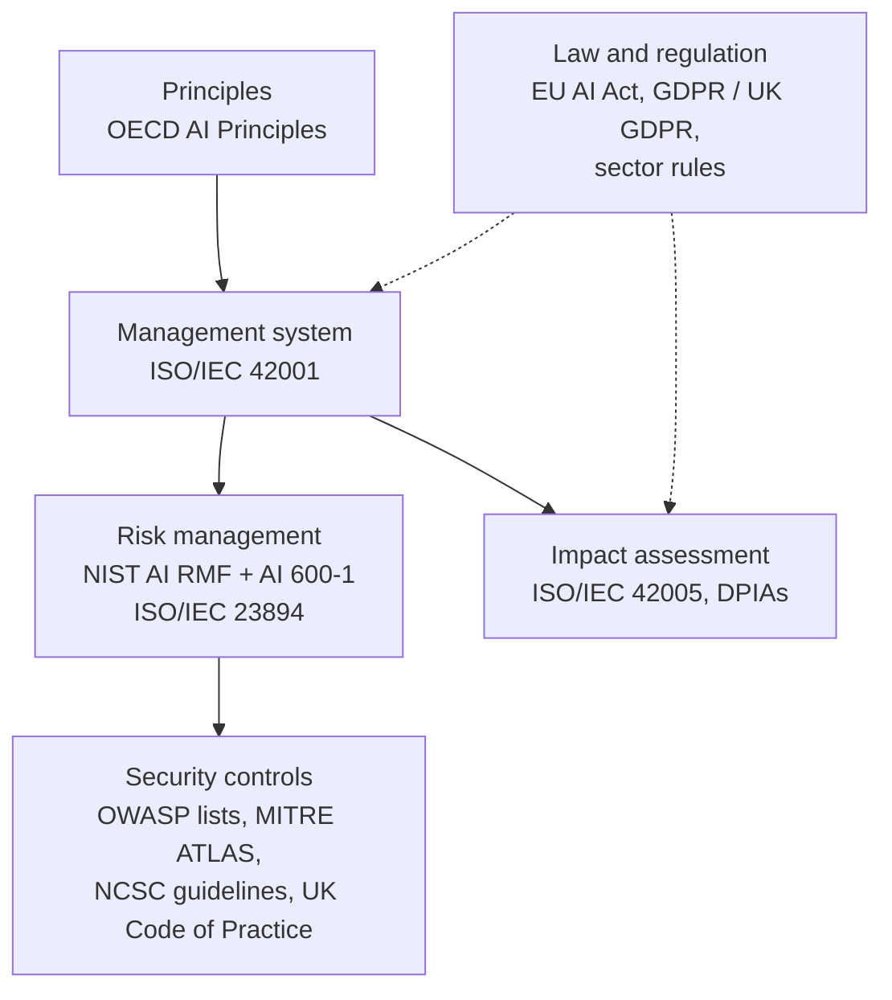

# Standards and frameworks

> **Who this is for:** Anyone who needs the authoritative source behind the guidance in this repository
> **Last reviewed:** 2026-10

This page lists the main standards, frameworks, legislation and official guidance that this guide draws on. It describes each one: what it is, who publishes it, and when it's useful. It doesn't rank them. Most organisations use several together. For example, an organisation might use a management system standard to structure its governance, a risk framework to assess individual systems, and a security list to test applications.

**Before relying on a status or date, check the publisher's page.** Some standards are paywalled. Where that's the case, it's noted.

## Management systems and governance

| Name | Publisher | What it is | Typically useful for | Access |
|---|---|---|---|---|
| [ISO/IEC 42001:2023](https://www.iso.org/standard/42001) | ISO / IEC | Requirements for an AI management system (AIMS): policies, objectives, roles, risk and impact processes, and continual improvement. Certifiable. | Organisations wanting a formal, auditable governance structure, especially those already running ISO 27001 or ISO 9001 | Paid |
| [ISO/IEC 23894:2023](https://www.iso.org/standard/77304.html) | ISO / IEC | Guidance on AI risk management, building on ISO 31000 | Adapting an existing enterprise risk process to AI | Paid |
| [ISO/IEC 42005:2025](https://www.iso.org/standard/44545.html) | ISO / IEC | Guidance on AI system impact assessment: assessing effects on individuals, groups and society | Structuring impact assessments for specific AI systems | Paid |
| [OECD AI Principles](https://oecd.ai/en/ai-principles) | OECD | Intergovernmental principles for trustworthy AI, adopted 2019 and updated 2024 | A widely recognised reference set of values for policies | Free |

## Risk management

| Name | Publisher | What it is | Typically useful for | Access |
|---|---|---|---|---|
| [AI Risk Management Framework (AI RMF 1.0)](https://www.nist.gov/itl/ai-risk-management-framework) | NIST (US) | Voluntary framework organised around four functions: Govern, Map, Measure, Manage | A practical, free structure for AI risk work, used internationally | Free |
| [NIST AI 600-1: Generative AI Profile](https://www.nist.gov/publications/artificial-intelligence-risk-management-framework-generative-artificial-intelligence) | NIST (US) | Companion to the AI RMF covering risks specific to generative AI, with suggested actions | Risk assessments for generative AI tools and applications | Free |

## Security

| Name | Publisher | What it is | Typically useful for | Access |
|---|---|---|---|---|
| [OWASP Top 10 for LLM Applications (2026)](https://genai.owasp.org/resource/owasp-genai-llm-top-10-2026/) | OWASP GenAI Security Project | Community list of the most critical security risks in applications built on large language models. The 2026 edition replaces the 2025 list; see [Security](../docs/governance/security.md) for the mapping. | Secure design, code review and testing of LLM applications | Free |
| [OWASP Top 10 for Agentic Applications](https://genai.owasp.org/resource/owasp-top-10-for-agentic-applications/) | OWASP GenAI Security Project | Companion list for risks specific to autonomous and tool-using AI agents, published December 2025 | Designing and assessing AI agents | Free |
| [MITRE ATLAS](https://atlas.mitre.org/) | MITRE | Knowledge base of adversary tactics and techniques against AI systems, modelled on ATT&CK | Threat modelling and red-team planning | Free |
| [Guidelines for secure AI system development](https://www.ncsc.gov.uk/collection/guidelines-secure-ai-system-development) | UK NCSC, US CISA and international partners | Guidance across design, development, deployment and operation | Organisations building or integrating AI systems | Free |
| [Code of Practice for the Cyber Security of AI](https://www.gov.uk/government/publications/ai-cyber-security-code-of-practice/code-of-practice-for-the-cyber-security-of-ai) | UK Government (January 2025) | Voluntary baseline security principles across the AI lifecycle, with an implementation guide. Submitted to ETSI as the basis for a global standard. | Security baselines for developers and system operators | Free |

## Legislation and regulatory guidance

These are summarised in [Regulation overview](../docs/governance/regulation-overview.md) and [Data protection](../docs/governance/data-protection.md). The primary sources are:

| Name | Jurisdiction | What it is | Access |
|---|---|---|---|
| [Regulation (EU) 2024/1689 (the AI Act)](https://eur-lex.europa.eu/eli/reg/2024/1689/oj) | European Union | Risk-based regulation of AI systems and general-purpose AI models. Obligations apply in phases; check the regulation overview for current dates. | Free |
| [ICO guidance on AI and data protection](https://ico.org.uk/for-organisations/uk-gdpr-guidance-and-resources/artificial-intelligence/) | United Kingdom | The UK data protection regulator's guidance on applying UK GDPR to AI | Free |

## How these fit together

Law sets obligations. Principles set intent. A management system makes both repeatable. Risk and impact assessments apply them to individual systems. Security frameworks supply the specific controls.

## Suggesting additions

To propose a standard or framework for this list, open a [content proposal](https://github.com/archaitect-net/transformaition/issues/new/choose). Include a link to the publisher's own page.
